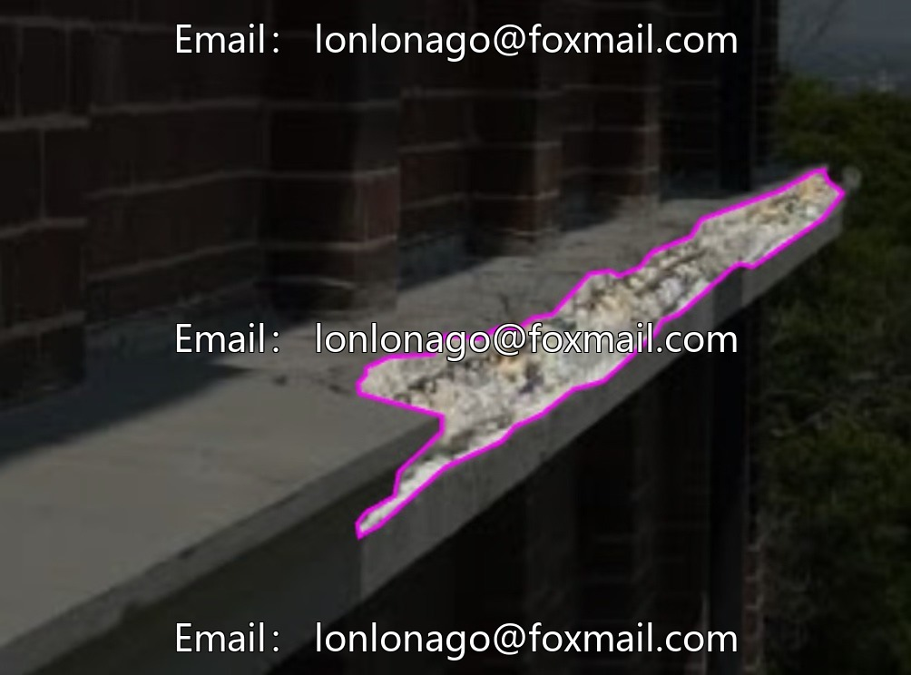
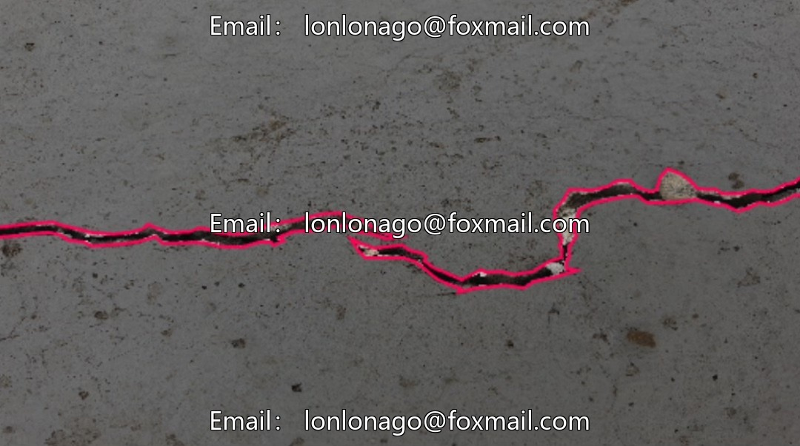
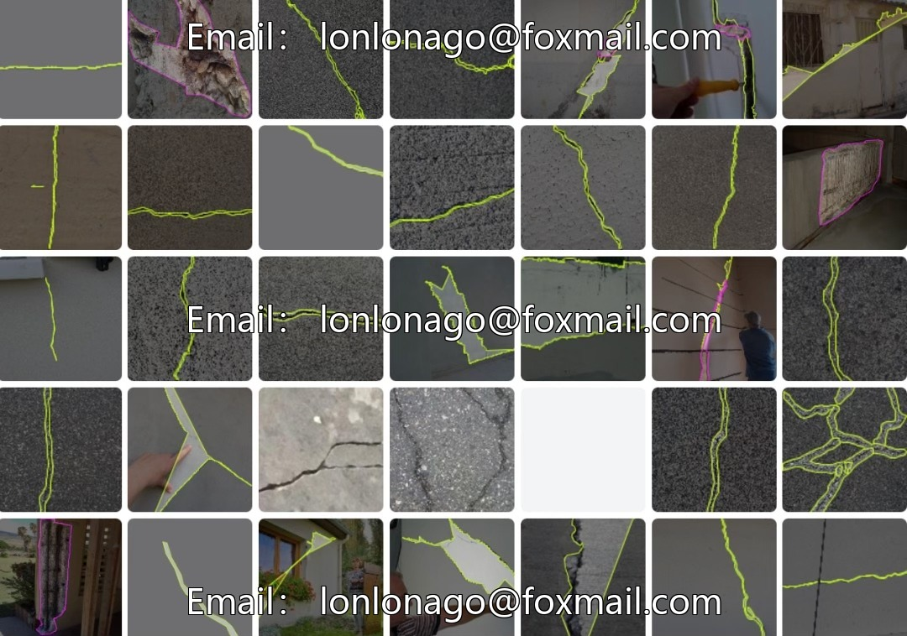
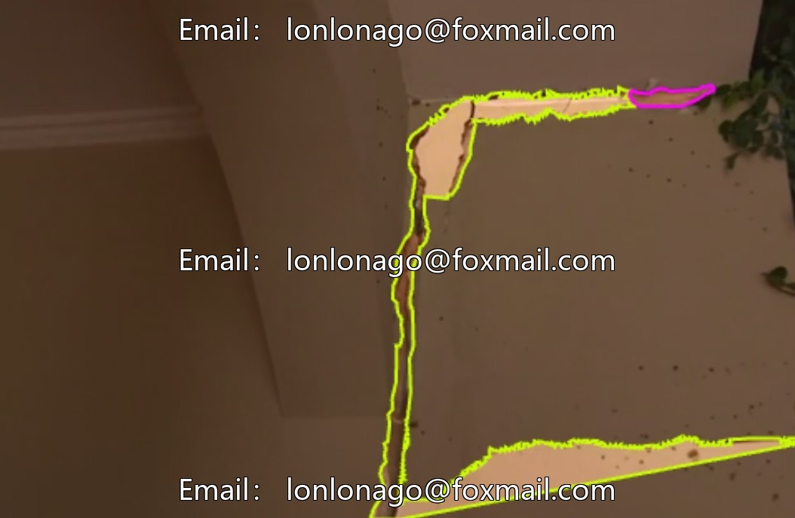
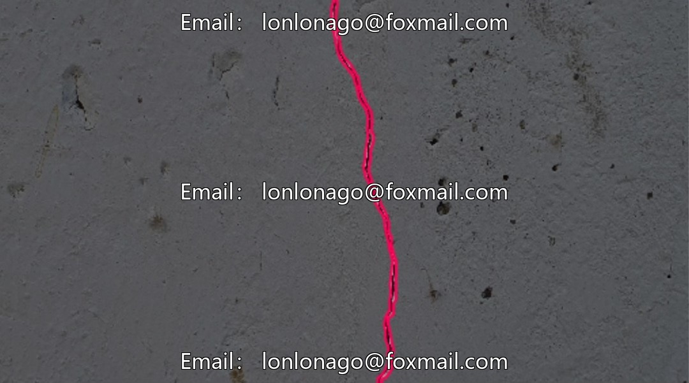
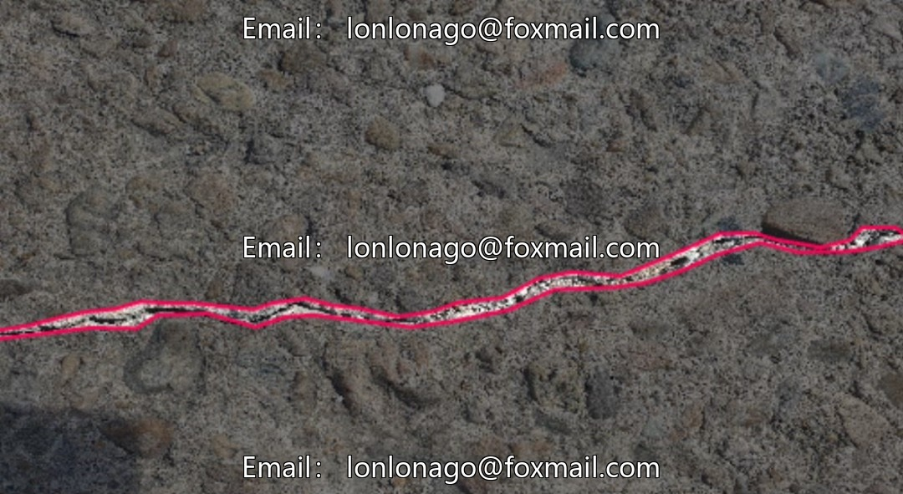

# Building Delamination and Crack Segmentation Recognition Dataset Based on YOLOv13, including wall cracks.

## Body

Building Defect Segmentation and Identification Dataset based on YOLOv13, including wall cracks, concrete cracks, interior wall peeling, etc., suitable for structural disease detection scenarios such as buildings and roads. The dataset format is YOLO, containing two categories: cracks and peeling, totaling 3100 labeled images covering instance segmentation needs, supporting model training and validation.

The data volume is sufficient, with no redundant classifications, which facilitates the model's precise learning of defect features. Can be directly used for instance segmentation model training, improve the accuracy of defect recognition algorithm, and provide data support for automated detection.

Virtual materials, once sold, are non-refundable.
Interested friends, click "I want" to proceed.

## Images

## Payment

Here is a pay link on Stripe ( https://buy.stripe.com/3cs8yP7sY87d0vu9AB ). Please contact me lonlonago@foxmail.com after funding $89, and I will send you a complete data files , thank you!

